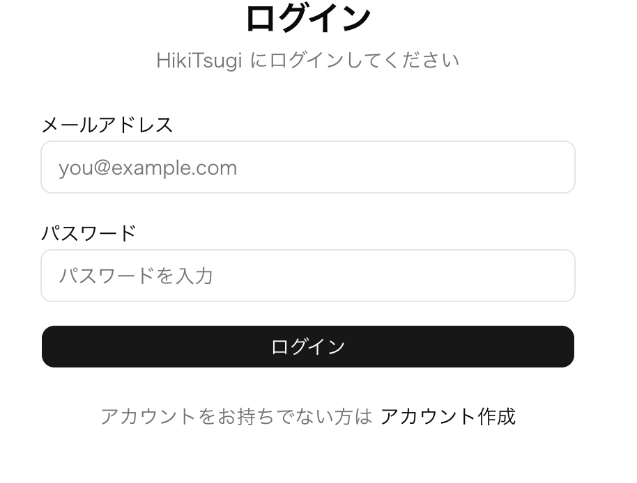
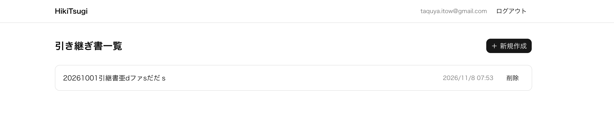
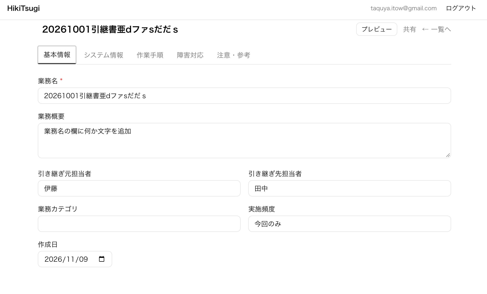
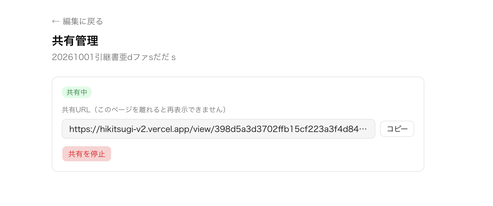

# HikiTsugi v2

> IT業務の引き継ぎ書を、フォーム入力だけで作れる Web アプリ

**公開 URL:** https://hikitsugi-v2.vercel.app  
**リポジトリ:** https://github.com/Takuya-11/HikiTsugi-v2

---

## 概要

IT運用担当者が業務を引き継ぐとき、手順書の形式がバラバラで抜け漏れが起きやすいという問題があります。

HikiTsugi v2 は、決まったフォームに入力するだけで統一フォーマットの引き継ぎ書を作れる Web アプリです。作成した引き継ぎ書はワンクリックで共有URLを発行でき、受け手はログインなしで閲覧できます。

---

## 主な機能

| 機能 | 説明 |
|---|---|
| 5セクション構成のフォーム | 基本情報・システム情報・作業手順・障害対応・注意事項の5セクションで引き継ぎ書を作成 |
| 自動保存 | 入力を止めてから2秒後に自動でサーバーへ保存。保存状態（保存中 / 保存済 / 保存失敗）をリアルタイム表示 |
| ローカルバックアップ | ネットワーク障害時は `localStorage` に自動バックアップ。再接続後に自動リカバリ |
| 競合検知・解消 | 複数タブで同一ドキュメントを編集した場合に競合を検知し、「サーバーの内容を読み込む」または「自分の変更を上書き」で解消 |
| 安全な共有URL | SHA-256 ハッシュトークンで共有URLを発行。DBには平文トークンを保存しない。再発行時は旧URLを即時失効 |
| 匿名閲覧 | 共有URLはログイン不要で閲覧可能（閲覧専用、編集不可） |
| 印刷 / PDF出力 | A4サイズのプレビュー画面から印刷・PDF保存が可能 |
| 作業手順の並び替え | 作業手順は上下ボタンで順序変更が可能 |

---

## スクリーンショット

| ログイン画面 | ダッシュボード |
|---|---|
|  |  |

| 編集画面 | 共有管理画面 |
|---|---|
|  |  |

---

## 技術スタック

| カテゴリ | 技術 |
|---|---|
| フレームワーク | Next.js 16.4.5（App Router / Partial Prerender） |
| UI ライブラリ | React 19.3.0 |
| 言語 | TypeScript 5（strict モード） |
| スタイリング | Tailwind CSS 4 / @base-ui/react |
| 認証・DB | Supabase（Auth + PostgreSQL + RLS） |
| デプロイ | Vercel |
| ランタイム | Node.js 26（ローカル）/ Vercel Edge（本番） |

---

## アーキテクチャ

```
ブラウザ
  │
  ├─ 認証が必要なページ (/dashboard, /documents/*)
  │     └─ proxy.ts（Next.js Middleware）
  │           └─ Supabase Auth でセッション検証 → 未認証は /login へリダイレクト
  │
  ├─ 編集・保存
  │     └─ PATCH /api/documents/:id（楽観的排他制御 + version チェック）
  │           └─ Supabase DB（documents テーブル、RLS: 本人のみ）
  │
  └─ 共有閲覧ページ (/view/:token)
        └─ Server Component（認証不要）
              └─ SHA-256 ハッシュで share_tokens テーブルを検索
                    └─ Supabase Admin Client（Service Role Key / サーバー限定）
```

---

## ローカルセットアップ

### 前提条件

- Node.js 20.9.0 以上
- Supabase プロジェクト（新規作成または既存）

### 手順

```bash
# 1. リポジトリをクローン
git clone https://github.com/Takuya-11/HikiTsugi-v2.git
cd HikiTsugi-v2

# 2. 依存パッケージをインストール
npm install

# 3. 環境変数を設定
cp .env.local.example .env.local
# .env.local を開いて値を入力（下記「環境変数」セクション参照）

# 4. Supabase マイグレーションを適用
supabase link --project-ref <your-project-ref>
supabase db push

# 5. 開発サーバーを起動
npm run dev
# → http://localhost:3002 で起動
```

### 開発コマンド

```bash
npm run dev        # 開発サーバー起動（ポート 3002、Turbopack 有効）
npm run build      # 本番ビルド
npm run typecheck  # TypeScript 型チェック
npm run lint       # ESLint 実行
```

---

## 環境変数

`.env.local.example` を参考に `.env.local` を作成してください。

| 変数名 | 説明 | 公開範囲 |
|---|---|---|
| `NEXT_PUBLIC_SUPABASE_URL` | Supabase プロジェクト URL | クライアント公開可 |
| `NEXT_PUBLIC_SUPABASE_ANON_KEY` | Supabase anon key | クライアント公開可 |
| `SUPABASE_SERVICE_ROLE_KEY` | Supabase service role key | **サーバー限定**（絶対に公開しない） |

> `SUPABASE_SERVICE_ROLE_KEY` は `import 'server-only'` で保護されており、クライアントバンドルには含まれません。

Supabase ダッシュボード → `Settings` → `API` から値を確認できます。

---

## データベース構成

```sql
-- 引き継ぎ書本体
documents (
  id UUID PK,
  user_id UUID FK → auth.users,  -- RLS: 本人のみ CRUD
  title TEXT,
  data JSONB,                    -- 5セクションのフォームデータ全体
  version INT,                   -- 楽観的排他制御用
  created_at / updated_at TIMESTAMPTZ
)

-- 共有URL管理
share_tokens (
  id UUID PK,
  document_id UUID FK → documents,
  token_hash TEXT UNIQUE,        -- SHA-256 ハッシュのみ保存（平文は URL のみ）
  status TEXT ('active' | 'revoked'),
  expires_at / created_at / revoked_at TIMESTAMPTZ
)
```

マイグレーションファイル: `supabase/migrations/`

---

## ドキュメント

| ファイル | 内容 |
|---|---|
| `docs/requirements.md` | 機能要件・非機能要件・MVPチェックリスト |
| `docs/02_information-architecture.md` | 画面構成・ナビゲーション設計 |
| `CLAUDE.md` | 開発ガイドライン（Next.js 16 差異・状態管理パターン等） |

---

## ライセンス

MIT
