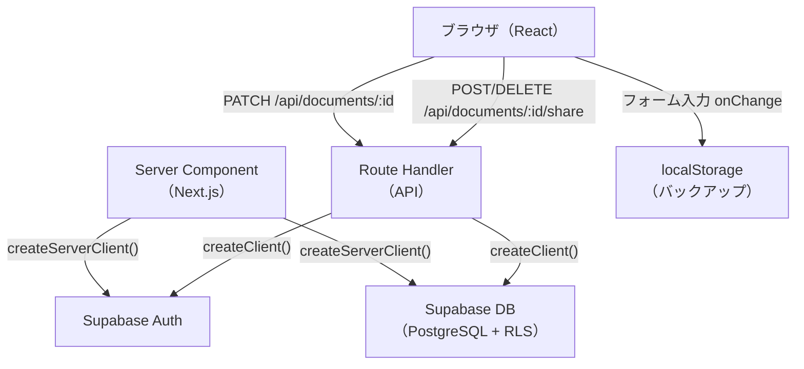
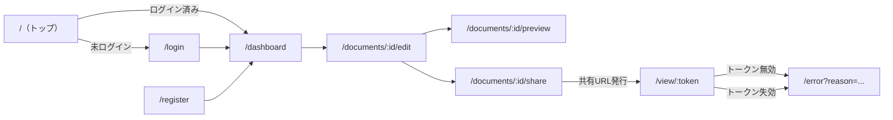
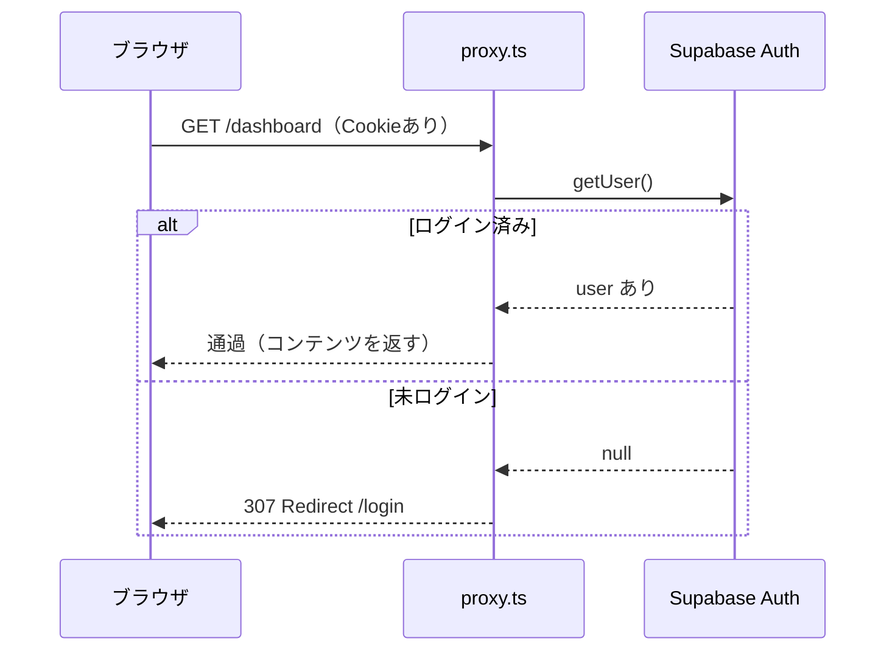
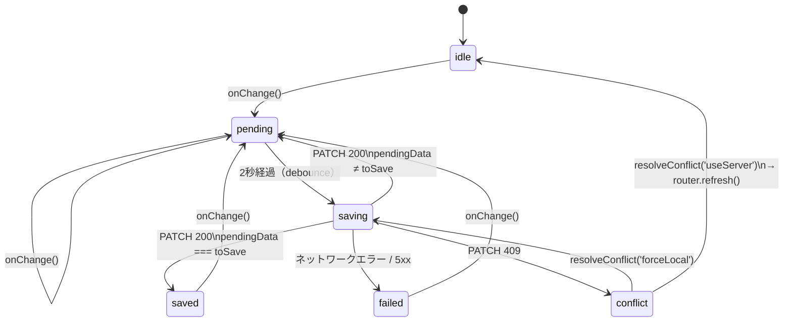
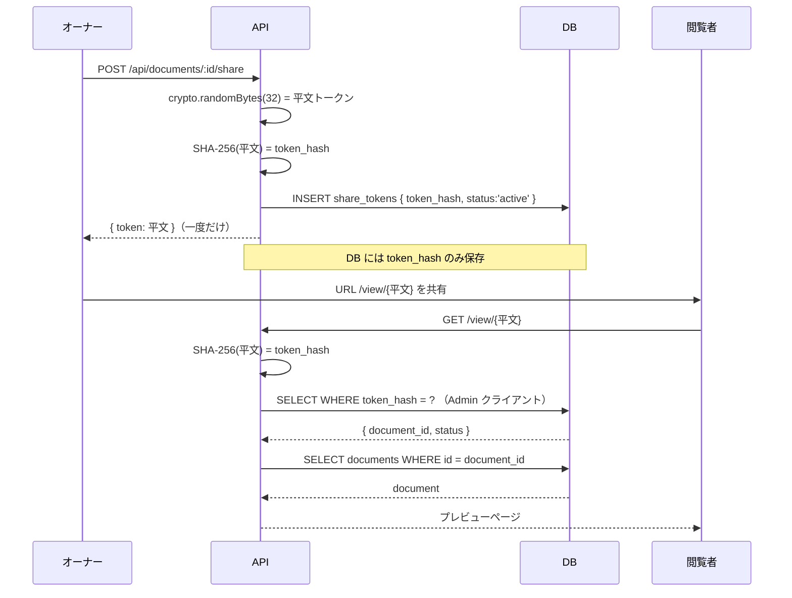

# アーキテクチャ図

## 1. 全体データフロー



---

## 2. ページルーティング



---

## 3. 認証フロー（proxy.ts）



**ファイル:** `proxy.ts`（Next.js 16 では `middleware.ts` ではなく `proxy.ts`）

---

## 4. 自動保存ステートマシン



**ファイル:** `hooks/useAutoSave.ts`

---

## 5. 共有トークンのセキュリティフロー



**ファイル:** `app/view/[token]/page.tsx`, `lib/token.ts`, `lib/supabase/admin.ts`

---

## 6. コンポーネントツリー（エディタ画面）

```
EditPage（Server Component）
└── DocumentEditor（Client Component）  ← 状態管理ハブ
    ├── [タブUI]
    ├── BasicInfoSection
    ├── SystemInfoSection
    ├── ProceduresSection
    │   └── [上下移動ボタン]
    ├── IncidentsSection
    ├── PrecautionsSection（Precautions + Reference[]）
    ├── [保存ステータス表示]
    └── [競合ダイアログ overlay]
```

**hooks:** `useAutoSave` が DocumentEditor 内で呼ばれる。各セクションは `onChange` コールバックで変更を上位へ伝える。

---

## 7. DB テーブル構造

```
documents
  id          UUID  PK
  user_id     UUID  FK → auth.users
  title       TEXT
  data        JSONB   （引き継ぎ書の全フィールド）
  version     INT     （楽観的排他制御）
  created_at  TIMESTAMPTZ
  updated_at  TIMESTAMPTZ  （自動更新トリガー）

share_tokens
  id           UUID  PK
  document_id  UUID  FK → documents.id
  token_hash   TEXT  UNIQUE  （SHA-256ハッシュ）
  status       TEXT  CHECK IN ('active','revoked')
  created_at   TIMESTAMPTZ
  revoked_at   TIMESTAMPTZ  NULLABLE
```

**RLS ポリシー:**
- `documents`: owner_all — `user_id = auth.uid()` の行のみ操作可能
- `share_tokens`: owner_all — `document_id` の owner のみ操作可能（anon は操作不可）
- 閲覧ページは `createAdminClient()`（Service Role Key）で RLS をバイパス

**マイグレーション:** `supabase/migrations/00001_initial_schema.sql`, `00002_fix_schema.sql`
